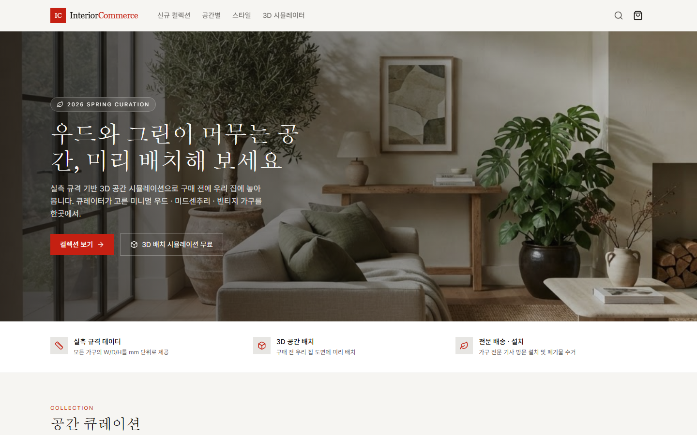
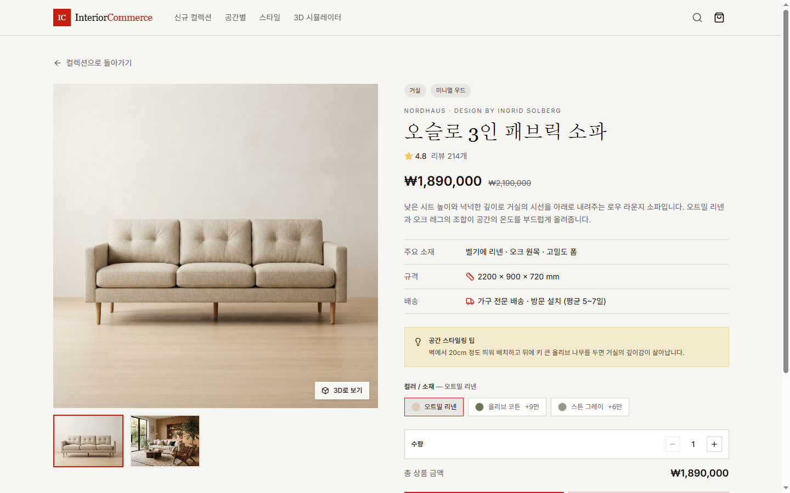
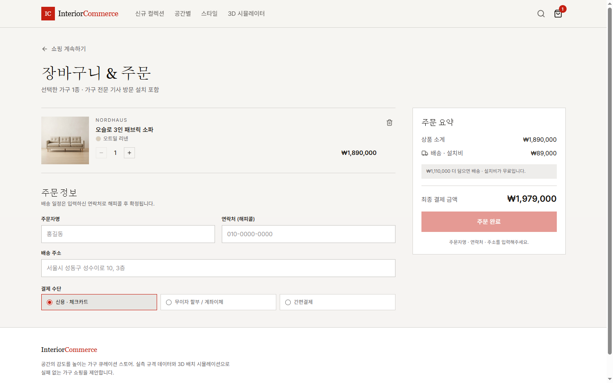
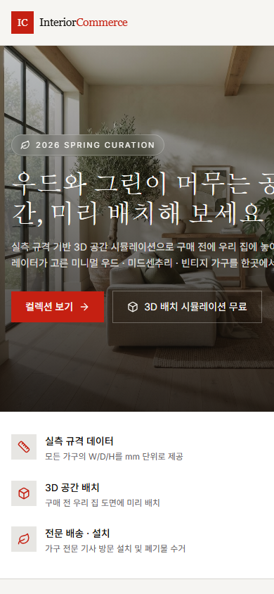

<div align="center">
  <h1 align="center">
    가구 커머스 플랫폼
    <br />
    <br />
    
  </h1>
</div>

<p align="center">
  
  
  
  
  
  
</p>

<p align="center"><a href="https://furniture-commerce-platform.vercel.app/">Live Demo</a></p>

## Introduction

**InteriorCommerce**는 공간 · 스타일별로 가구를 고르고, 실측 규격을 확인한 뒤 옵션을 골라 장바구니에 담는 흐름을 만든 가구 커머스 프로토타입입니다. v0로 화면을 만들고 Vercel로 배포했습니다.

- **공간 · 스타일로 고르기**

> 가구 7종을 거실 · 주방 같은 공간과 미니멀 우드 · 미드센추리 같은 스타일로 나눠 보여 줍니다.

- **실측 규격을 먼저 보여 주기**

> 모든 가구의 W/D/H를 mm 단위로 보여 줘, 우리 집에 들어가는지 먼저 확인하게 했습니다.

- **옵션별 장바구니**

> 같은 상품도 옵션이 다르면 따로 담고, 수량은 1–9개로 제한합니다. 목록에서 빠른 보기로 상세 화면을 열지 않고 미리 봅니다.

## 화면

| 상품 상세 | 장바구니 · 주문 정보 |
| --- | --- |
|  |  |

| 모바일 |
| --- |
|  |

## Installation

```bash
pnpm install
pnpm dev     # http://localhost:3000
pnpm build
```

## 기술 스택

| 구분 | 기술 |
| --- | --- |
| 프레임워크 | Next.js 16 (App Router), React 19, TypeScript |
| UI | Tailwind CSS 4, shadcn/ui · Base UI, lucide-react |
| 배포 · 분석 | Vercel, Vercel Analytics |

## 제작 방식

v0로 화면과 컴포넌트를 만들고, 이 저장소와 연결해 `main`에 병합될 때마다 Vercel에 자동 배포했습니다.

## 구조

```text
app/          layout · page (홈 / 상세 / 장바구니 화면 전환)
components/   home-view · product-detail-view · cart-view · quick-view-dialog · site-header · ui
lib/          products (상품 · 옵션 데이터) · cart
```

## Status

결제와 회원 기능이 없는 화면 프로토타입입니다. 상품 데이터는 예시이고, 3D 공간 배치 시뮬레이터는 미리보기 이미지를 띄우는 화면 목업입니다.

## Author

안정빈 — 기획 · v0 기반 구현 (개인)
